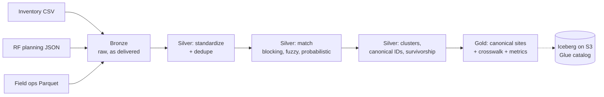

# Telecom Entity Resolution & Iceberg Lab

Three systems describe the same cell towers but share no common ID. This project works out which records describe the same physical site, builds one canonical site table with a crosswalk back to every source ID, and maintains it with Spark SQL and Apache Iceberg, first locally and then on S3, EMR Serverless and Glue.

**Stack:** Spark SQL · PySpark · Apache Iceberg · Parquet · AWS S3 · EMR Serverless · AWS Glue Data Catalog

> Part of my portfolio at **[devanshi4.github.io](https://devanshi4.github.io)**, which has an interactive demo of the matching

---

## The problem

A telecom operator keeps three views of its network, each owned by a different team:

| Source | Format | Grain | Has |
|---|---|---|---|
| Network inventory | CSV, all text | one row per site | name, street address, ZIP, coordinates, equipment |
| RF planning | JSON Lines, nested | one row per plan version | surveyed coordinates, technology, antennas |
| Field operations | Parquet, typed | one row per work order | free-text name and address, equipment on the tower |

There is no shared key. Names are abbreviated ("Bx Grand Concourse Site"), addresses are misspelled ("1250 GRAND CONCRS"), coordinates are rounded, and the same site can appear twice inside one source under an old ID. Two different towers 560 m apart on the same street have similar names. A naive join on name merges them, which is a false positive that quietly breaks every site-level report.

## The data is synthetic

Real network data can't be shared, so I hand-built the three source files to reproduce the problems I see at work. There are **78 source records describing 24 physical sites** in New York City, and each record tests one specific edge case. An answer key (`data/ground_truth/`) records which site every record truly belongs to, so matching quality is measured with precision and recall instead of judged by eye.

## How it works



The pipeline logic lives in SQL files (`sql/<layer>/`). A small Python runner starts Spark, substitutes `${KEY}` paths from `conf/<env>.env`, and runs each statement. Moving from laptop to AWS only swaps local paths for `s3://` paths. The SQL stays the same.

## Design decisions

- **Profile before matching.** Each source has a different grain, so the first step is to state it and check which pairs of sources share real evidence.
- **Inventory is the bridge.** RF planning and field operations share only a free-text name, which is weak evidence. Inventory is the only source with both coordinates and an address, so those two link through it (A = B and B = C, so A = C).
- **Ambiguity goes to review, not a guess.** A work order that says only "Grand Concourse, Bronx" could belong to either tower, so it's flagged for manual review.
- **Explicit survivorship rules.** When sources disagree, for example field ops reporting an equipment swap newer than inventory, a written rule decides which value wins and why.
- **Raw stays raw.** Bronze keeps every value exactly as delivered (CSV columns stay text), so any later layer can be rebuilt.

## Run it locally

You need Java 17 or 21 and Python 3.9–3.13.

1. Create a virtual environment and install dependencies:

   ```bash
   python3 -m venv .venv && source .venv/bin/activate
   ```

   ```bash
   pip install -r requirements.txt
   ```

2. Regenerate the source files and answer key (they're also committed):

   ```bash
   python data_generation/generate_sources.py
   ```

3. Profile the three sources:

   ```bash
   python jobs/run_sql.py sql/bronze/00_peek_sources.sql
   ```

## Project structure

```
├── conf/local.env               # paths for local runs (an AWS env file comes later)
├── data/raw/                    # the three sources, exactly as delivered
├── data/ground_truth/           # true_sites.csv and record -> site answer key
├── data_generation/             # hand-built source generator
├── jobs/run_sql.py              # runs a .sql file statement by statement
└── sql/bronze/                  # SQL per layer (silver/ and gold/ come next)
```

## Status and roadmap

This project is in progress and built in stages. Done so far: the synthetic sources, the answer key, and Bronze profiling.

1. Bronze landing as Iceberg tables
2. Standardization of names, addresses and coordinates
3. In-source deduplication and late-arriving versions
4. Deterministic matching with plain SQL joins
5. Blocking, so not every record is compared with every other
6. Fuzzy string and address matching
7. Probabilistic matching (Fellegi-Sunter weights and thresholds)
8. Clusters, canonical IDs and the crosswalk
9. Survivorship rules
10. Incremental updates with Iceberg `MERGE`
11. Gold tables and precision/recall against the answer key
12. Reading the Spark plans and UI for these jobs
13. Running on S3, EMR Serverless and the Glue Data Catalog

---

Built by **Devanshi Pandya** · [Portfolio](https://devanshi4.github.io) · [LinkedIn](https://www.linkedin.com/in/devanshi4/)
